# Especificación de vistas

Cada vista indica su plantilla, qué va en cada zona, sus estados y **qué no va en ella**. Las capturas corresponden al tema oscuro a 1440 px.

## Barra lateral (componente)

- Marca «Agent Hub» · «Buscar o ir a…» (⌘K) · Inicio con contador de pendientes.
- Grupo **Trabajo**: Proyectos, Memoria, Colaboración, Automatizaciones.
- Grupo **Conexiones**: Servidores MCP (contador `attn` si hay alguno que requiere atención), Skills, Clientes, Actividad.
- Pie: Ajustes y una línea de estado: punto de color + nombre del equipo (con elipsis y nombre completo en el tooltip) + «Sincronizado hace 2 min» + botón «Sincronizar ahora».
- **No va:** tarjetas, lemas, versión, contadores informativos (solo los de atención y pendientes).

## Inicio

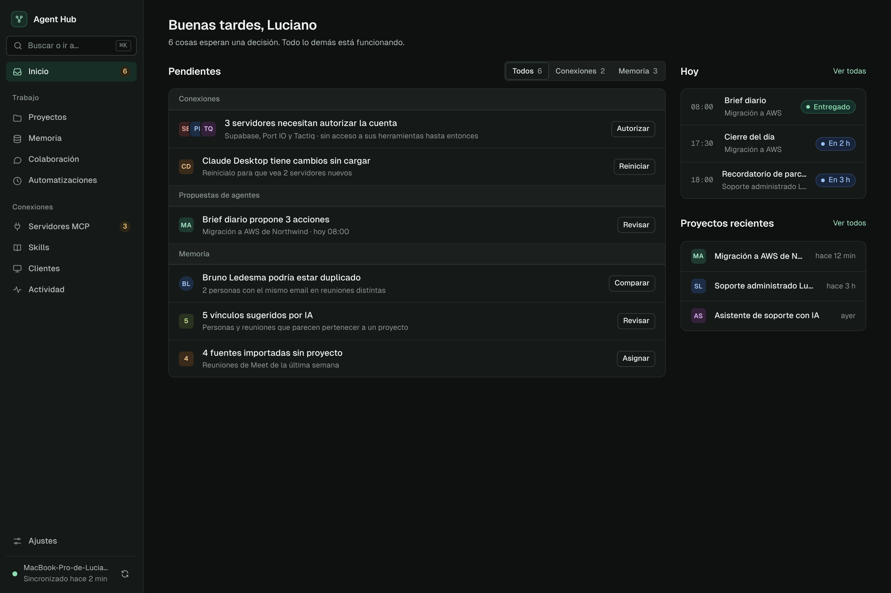

- **Plantilla:** D · Bandeja.
- **Encabezado:** saludo + una línea con el número de pendientes.
- **Pendientes:** agrupados por Conexiones, Propuestas de agentes y Memoria; segmentado con contadores. Cada fila: identidad, título que dice qué pasa, detalle con la consecuencia, **una** acción.
- **Columna:** «Hoy» (automatizaciones del día con hora en mono y chip) y «Proyectos recientes».
- **Estados:** sin pendientes → «Nada pendiente», sin acción.
- **No va:** métricas, gráficos, accesos directos de creación, novedades de la app.

## Proyectos

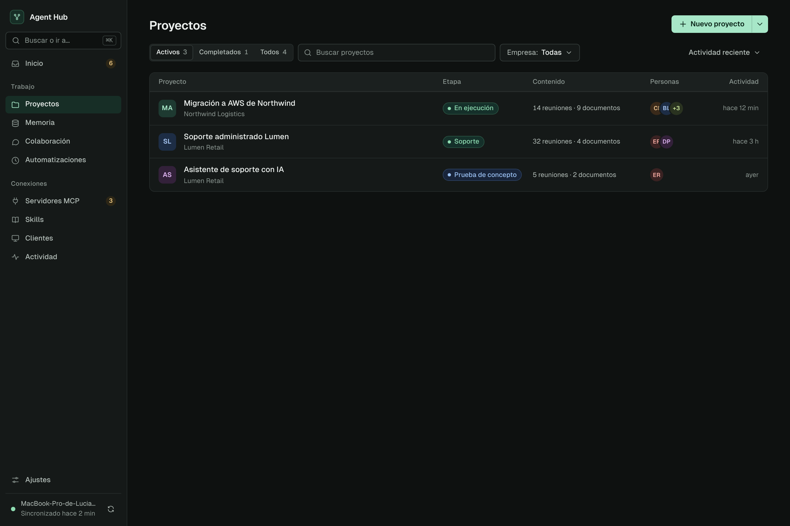

- **Plantilla:** A sin panel (las filas abren la ficha).
- **Encabezado:** «Nuevo proyecto» dividido; el menú ofrece «Unirme con una invitación» y «Restaurar desde un respaldo».
- **Barra:** Activos / Completados / Todos · buscar · Empresa · orden.
- **Fila:** avatar con tono propio, nombre + empresa, etapa (chip traducido), conteo de contenido, personas, actividad relativa.
- **No va:** tiles de totales, «Conectar fuentes», «Buscar proyecto de fuentes sin asignar» (va a Inicio).

## Proyecto (ficha)

- **Plantilla:** B · Ficha.
- **Identidad:** avatar, título editable en línea, chip de etapa, empresa enlazada, actualización relativa.
- **Acciones:** Compartir (con avatares de quienes tienen acceso), **Agregar** (primario: nota, archivos, tarea), «…» (Editar detalles, Vincular, Archivar, Eliminar).
- **Pestañas:** Resumen · Contenido · Tareas · Decisiones · Colaboración.
  - **Resumen:** descripción, Última actividad (4 elementos), Tareas abiertas (2) con «Ver las N».
  - **Contenido:** segmentado por tipo (Todo, Reuniones, Documentos, Notas, Colecciones) + filtro.
  - **Tareas:** campo «Agregar una tarea y presionar Enter» (sin modal) + grupos En curso, Bloqueadas, Por hacer.
  - **Decisiones:** decisiones y hallazgos con descripción de 2 líneas.
  - **Colaboración:** hilos del proyecto + personas con acceso y permisos.
- **Columna de datos:** Detalles (empresa, etapa, carpetas, IA remota), Automatizaciones (interruptores Brief diario y Cierre del día), Conexiones (con «Vincular»).
- **No va:** paginación de 4 elementos, «Información adicional e historial» desplegable (va en «…» › Historial), chips de tipo «Proyecto».

| Contenido | Tareas |
|---|---|
| 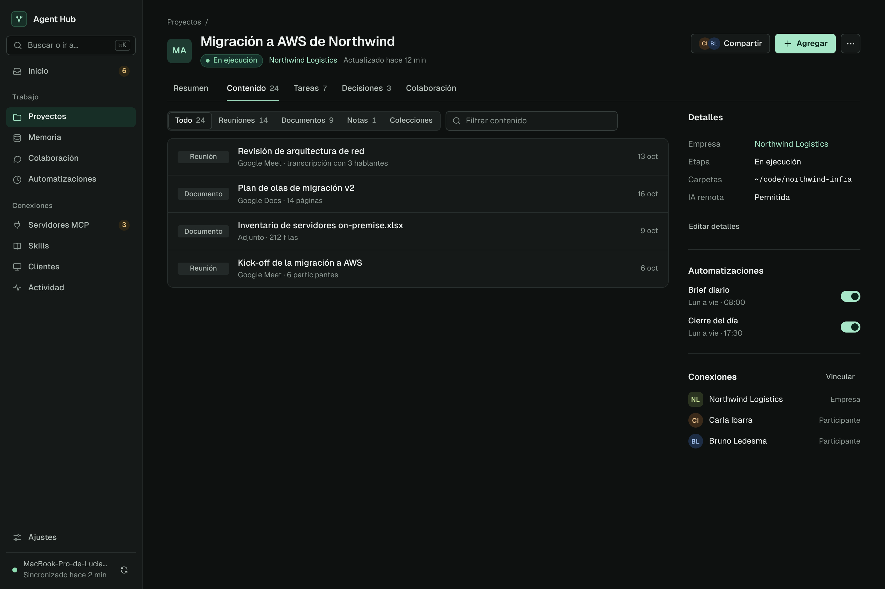 | 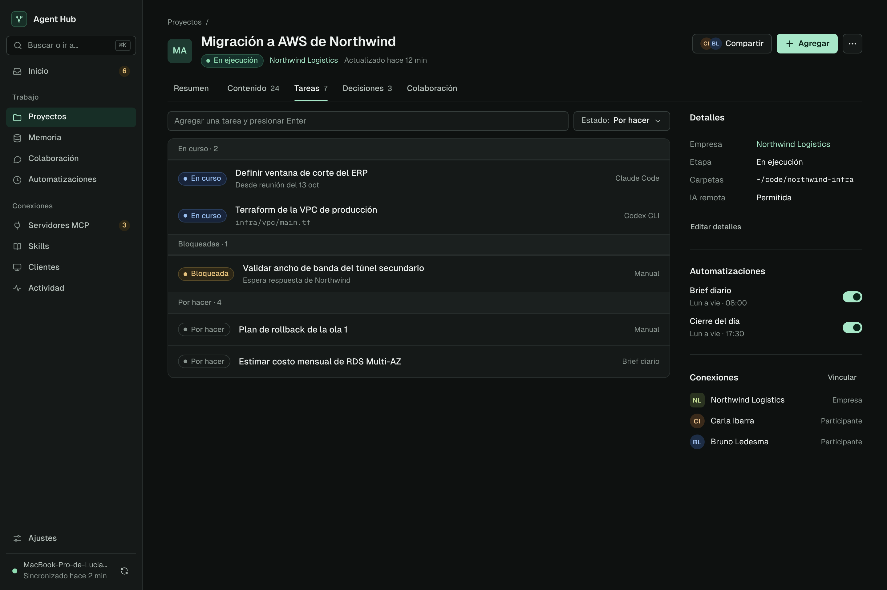 |

## Memoria

- **Plantilla:** A sin panel (los resultados abren la ficha de la entidad).
- **Búsqueda:** campo grande (44 px). Sin texto, la lista muestra todo lo reciente; con texto, busca por significado y muestra la cita con la coincidencia resaltada.
- **Filtros:** Tipo, Proyecto, Persona, Fecha (selectores propios; el filtro activo tiene borde de acento y X para quitarlo).
- **Encabezado:** «Nueva nota» (primario), «…» › Nueva colección.
- **No va:** pestañas Explorar/Buscar, campos de fecha nativos, paginación «Anterior/Siguiente» (scroll con carga progresiva).

## Reunión (ficha de entidad)

- **Plantilla:** B. Persona y Empresa usan la misma ficha con otras pestañas.
- **Pestañas:** Resumen · Transcripción.
- **Transcripción:** filtro por hablante (segmentado) + búsqueda. Cada fragmento: avatar, nombre, minuto en mono, texto en `.prose`. Las acciones «Citar» y «Corregir contexto» aparecen al pasar el cursor.
- **Columna:** Detalles (proyecto, fuente, versión, procesada), Hablantes (con email), Derivado de esta reunión.
- **Acciones:** solo «…» (Editar, Reprocesar, Inferir emails, Eliminar). Una reunión no tiene primario.
- **No va:** selector de versión visible (va en Detalles), resumen «Hablantes 3/3 con email» como bloque aparte.

## Colaboración

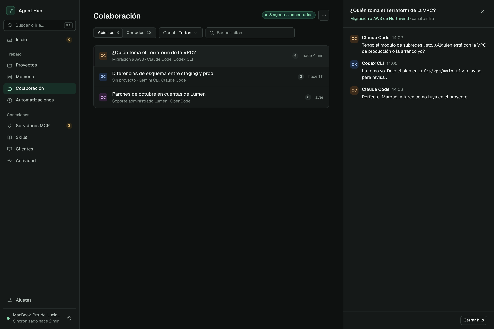

- **Plantilla:** A con panel.
- **Encabezado:** chip «3 agentes conectados» + «…» (Canales, Papelera).
- **Barra:** Abiertos / Cerrados · Canal · buscar.
- **Panel:** el hilo completo, con proyecto y canal; pie con «Cerrar hilo».
- **No va:** bloques «Conexión y preferencias» o «Cómo se organizan» (van a Ajustes › Colaboración y red), botón «Mostrar agentes».

## Automatizaciones

- **Plantilla:** A con panel.
- **Barra:** Activas / Pausadas / Historial · Proyecto.
- **Fila:** proyecto (avatar), nombre, proyecto + recurrencia, próxima ejecución (columna fija de 110 px, nunca cortada), interruptor (pausar/reanudar con Deshacer).
- **Panel:** «Ejecutar ahora» (sin confirmación) y «…» (Eliminar, con Deshacer). Cuándo (días + hora, guardado automático), Entregar en (canales), Últimas entregas con «Revisar» si hay propuestas.
- **Estados:** si las automatizaciones están desactivadas en Ajustes → un aviso de página con «Activar».
- **No va:** pestañas Programaciones/Entregas, modales «Cambiar horario», «Canales», «Ejecutar ahora», «Cancelar», columna «Creado por» con notas pegadas.

## Servidores MCP

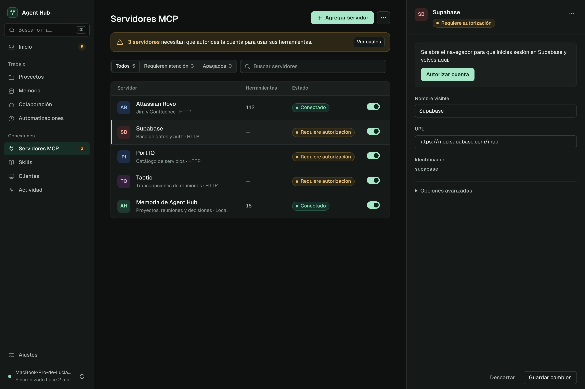

- **Plantilla:** A con panel.
- **Aviso:** uno, si hay servidores que requieren autorización, con «Ver cuáles» (aplica el filtro).
- **Encabezado:** «Agregar servidor» (primario) · «…» › Importar JSON.
- **Barra:** Todos / Requieren atención / Apagados · buscar.
- **Fila:** avatar, nombre + descripción · transporte, herramientas, estado, interruptor.
- **Panel:** bloque «Autorizar cuenta» si corresponde; nombre, URL, identificador (solo lectura); Opciones avanzadas (encabezados, credenciales propias); «…» (Probar conexión, Eliminar). Herramientas: lista en una sección del panel.
- **No va:** aviso rojo por tarjeta, «Conectar tus clientes» por tarjeta, franja de 4 métricas, acordeón de herramientas en la lista.

## Skills

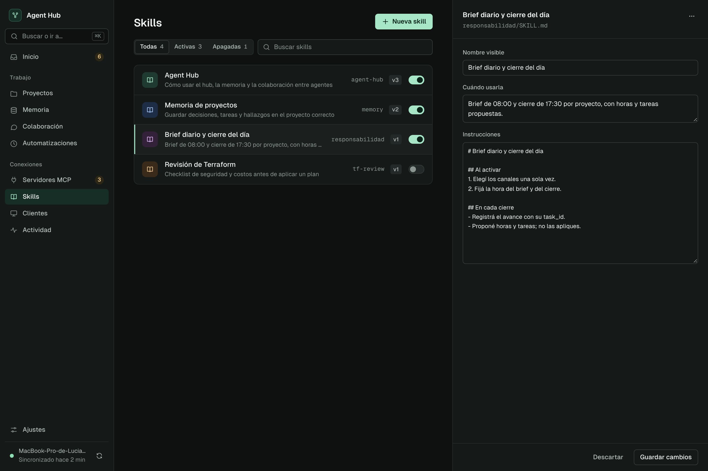

- **Plantilla:** A con panel ancho (520 px).
- **Encabezado:** «Nueva skill» (abre el panel vacío, no un modal).
- **Fila:** icono, nombre + cuándo usarla, slug en mono, versión, interruptor.
- **Panel:** nombre, «Cuándo usarla», instrucciones (editor mono); «…» (Exportar para claude.ai, Duplicar, Eliminar).
- **No va:** botón «ZIP para claude.ai» en el encabezado ni en cada fila; desplegable con el SKILL.md en la lista.

## Clientes

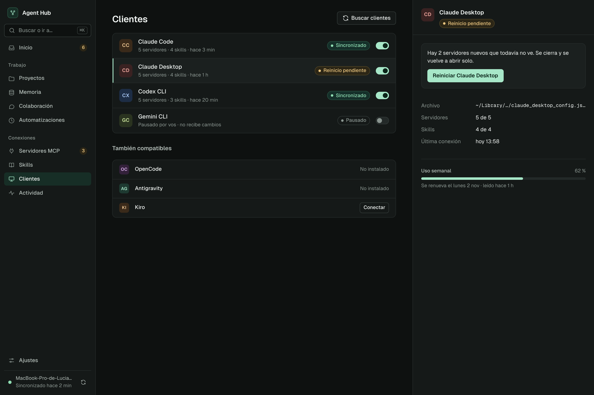

- **Plantilla:** A con panel.
- **Encabezado:** «Buscar clientes» (secundario; no hay primario).
- **Lista:** clientes detectados con estado y pausa. Debajo, «También compatibles»: no instalados (texto) o instalados sin conectar («Conectar»).
- **Panel:** bloque de acción si hay reinicio pendiente; archivo administrado (ruta acortada al medio), servidores, skills, última conexión; Uso semanal (barra + renovación).
- **No va:** aviso informativo sobre detección automática, sección «Cuotas de uso» aparte, bordes punteados.

## Actividad

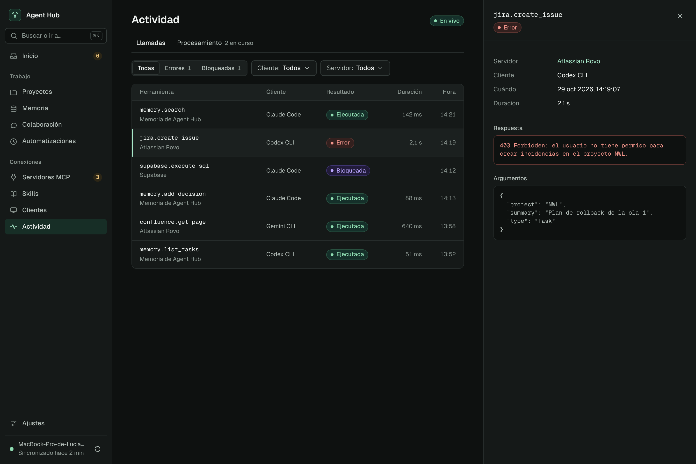

- **Plantilla:** A con panel.
- **Pestañas:** Llamadas · Procesamiento.
- **Encabezado:** chip «En vivo» (no hay botón «Actualizar»).
- **Barra:** Todas / Errores / Bloqueadas (separados) · Cliente · Servidor.
- **Fila:** herramienta en mono + servidor, cliente, resultado (Ejecutada `c-ok`, Error `c-danger`, Bloqueada `c-locked`), duración, hora.
- **Panel:** detalles, respuesta (caja con borde de error si falló), argumentos.
- **No va:** desplegable «Ver detalle» dentro de la fila, Error y Bloqueada en el mismo color.

## Ajustes

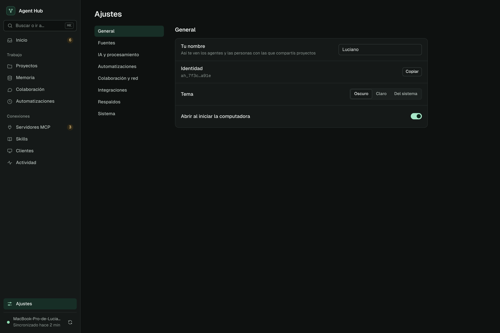

- **Plantilla:** C.
- **Secciones:** General · Fuentes · IA y procesamiento · Automatizaciones · Colaboración y red · Integraciones · Respaldos · Sistema.
- **Fila de ajuste:** etiqueta + una línea de ayuda opcional, control a la derecha. Guardado automático.
- **Mantenimiento** (reprocesar, buscar duplicados, reorganizar): botones que ejecutan y avisan con toast; el progreso se ve en Actividad › Procesamiento.
- **Respaldos:** «Restaurar» es la única confirmación de la app.
- **No va:** tarjetas por sección, Jira en dos lugares, avisos tras cada guardado.

| IA y procesamiento | Integraciones |
|---|---|
| 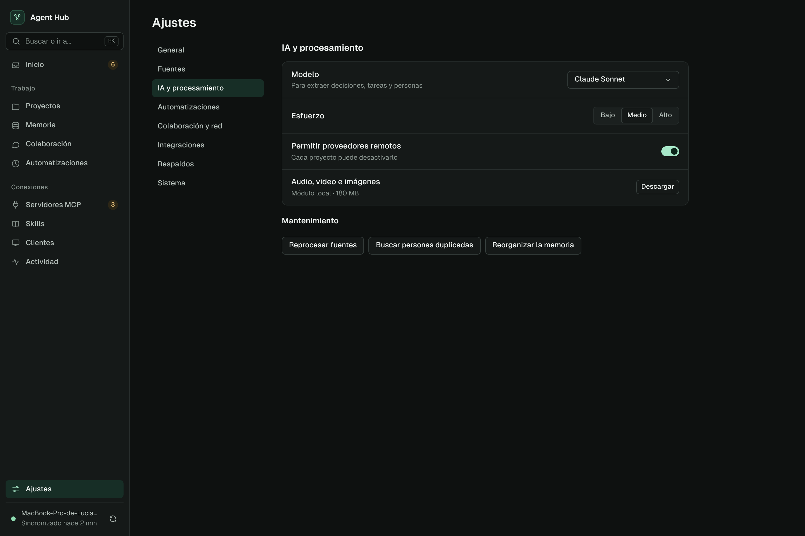 |  |
